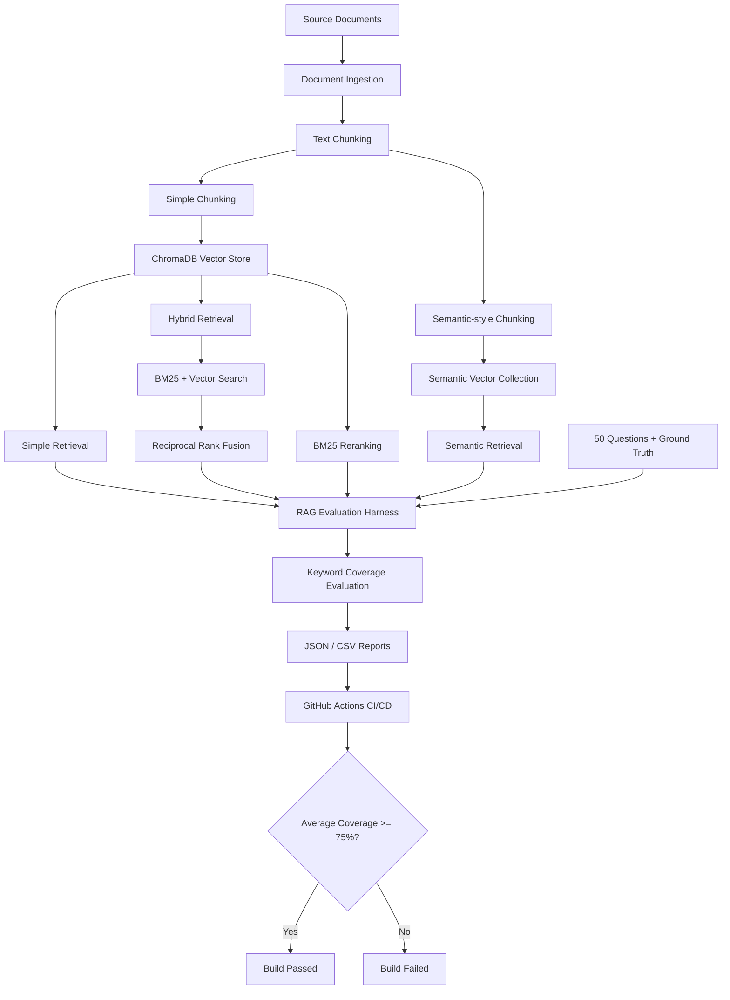

# RAG Evaluation Harness

[](https://github.com/gayatri212206/RAG-Eval-Harness/actions/workflows/evaluation.yml)

A Retrieval-Augmented Generation (RAG) evaluation framework that compares four retrieval strategies using a dataset of 50 questions and 200 evaluation tests.

The project measures retrieval quality through Ground Truth Keyword Coverage and uses GitHub Actions to automatically run evaluations and enforce a minimum performance threshold.

## 1. Project Overview

Retrieval quality plays an important role in RAG systems. Different retrieval strategies can return different results for the same query.

This project evaluates and compares four retrieval approaches:

- Simple Chunking
- Semantic-style Chunking
- Hybrid Search
- Reranking

It helps identify which retrieval strategy provides better coverage of the expected answer.

## 2. Key Features

- **50 Evaluation Questions:** A custom dataset containing questions and corresponding ground-truth answers.
- **Four Retrieval Strategies:** Compares Simple, Semantic-style, Hybrid, and Reranking methods.
- **Vector Search:** Uses ChromaDB with its default ONNX embedding model.
- **Hybrid Retrieval:** Combines vector search and BM25 using Reciprocal Rank Fusion (RRF).
- **Reranking:** Reorders retrieved candidates using BM25 scores.
- **Automated Evaluation:** Runs 200 tests across four retrieval methods.
- **Evaluation Reports:** Generates JSON and CSV reports.
- **CI/CD Integration:** GitHub Actions automatically executes the evaluation and checks the performance threshold.

## 3. Technology Stack

| Technology | Purpose |
|---|---|
| Python | Core programming |
| ChromaDB | Vector database |
| ONNX Runtime | Embedding generation |
| BM25 | Keyword-based retrieval and reranking |
| NumPy | Numerical operations |
| Pandas | Data handling |
| Scikit-learn | Supporting ML utilities |
| GitHub Actions | CI/CD automation |


## 4. System Architecture




## 5. Retrieval Methods

| Method | Description |
|---|---|
| Simple | Fixed-size chunking with vector similarity search |
| Semantic-style | Paragraph and sentence-boundary-based chunking with vector search |
| Hybrid | Combines vector retrieval and BM25 using RRF |
| Reranking | Reorders initial vector retrieval candidates using BM25 |

**Note:** Semantic-style chunking currently uses paragraph and sentence boundaries; it does not use embedding-similarity-based semantic segmentation. Reranking uses BM25 rather than a neural cross-encoder.

## 6. Evaluation Results

The framework evaluates 50 questions using four retrieval methods, resulting in 200 total evaluation tests.

| Retrieval Method | Average Coverage |
|---|---:|
| Simple | 84.67% |
| Semantic | 85.41% |
| Hybrid | 83.10% |
| Reranking | 62.55% |

**Best-performing method:** Semantic-style Retrieval — 85.41%

The average coverage across all four methods is approximately 78.93%.

### Evaluation Metric

The project uses Ground Truth Keyword Coverage.

It measures the proportion of unique, non-stopword terms in the ground-truth answer that also appear in the retrieved context.

This is a retrieval coverage proxy, not a measure of complete answer correctness or factual accuracy.

## 7. Project Structure

```text
RAG-Eval-Harness/
│
├── .github/
│   └── workflows/
│       └── evaluation.yml
│
├── data/
│   ├── documents/
│   │   └── python_basics.txt
│   └── evaluation_dataset.json
│
├── results/
│   ├── evaluation_results.csv
│   ├── evaluation_results.json
│   └── evaluation_summary.json
│
├── src/
│   ├── retrieval/
│   │   ├── simple.py
│   │   ├── semantic.py
│   │   ├── hybrid.py
│   │   └── reranking.py
│   │
│   ├── evaluation/
│   │   └── evaluator.py
│   │
│   ├── ingestion.py
│   ├── chunking.py
│   ├── embeddings.py
│   └── vector_store.py
│
├── requirements.txt
└── README.md
```

## 8. Installation and Setup

### Prerequisites

- Python 3.12
- Git
- Internet connection for installing dependencies and downloading the embedding model on first use

### Step 1: Clone the repository

```bash
git clone https://github.com/gayatri212206/RAG-Eval-Harness.git
cd RAG-Eval-Harness
```

### Step 2: Create a virtual environment

Windows PowerShell:

```powershell
python -m venv .venv
.venv\Scripts\Activate.ps1
```

### Step 3: Install dependencies

```powershell
python -m pip install -r requirements.txt
```

### Step 4: Run the evaluation

```powershell
python -m src.evaluation.evaluator
```

The evaluation will run all four retrieval methods against the 50-question dataset.

## 9. Evaluation Reports

After execution, the following reports are generated inside the `results/` directory:

- `evaluation_results.json` — Detailed evaluation results.
- `evaluation_results.csv` — Tabular evaluation results.
- `evaluation_summary.json` — Average coverage for each retrieval method.

## 10. GitHub Actions CI/CD

The project uses GitHub Actions to automate evaluation.

The workflow runs on:

- Push to the `main` branch.
- Pull requests targeting `main`.
- Manual workflow dispatch.

### CI/CD Pipeline

1. Checkout the repository.
2. Set up Python 3.12.
3. Install project dependencies.
4. Run the RAG evaluation.
5. Check the average coverage threshold.

The pipeline passes when all four methods produce results and their average coverage is at least 75%.

If the threshold is not met, the workflow fails.

[View GitHub Actions](https://github.com/gayatri212206/RAG-Eval-Harness/actions)

## 11. Current Limitations

- Evaluation currently uses a single Python programming document.
- The dataset contains 50 questions.
- Keyword coverage does not fully measure semantic correctness.
- Semantic-style chunking is based on text boundaries rather than embedding similarity.
- BM25 is used for reranking instead of a neural reranking model.

## 12. Future Improvements

- Add more source documents and domain-specific datasets.
- Implement Recall@K, Precision@K and Mean Reciprocal Rank (MRR).
- Explore embedding-based semantic chunking.
- Integrate neural cross-encoder reranking.
- Build an interactive evaluation dashboard.
- Deploy a live project demonstration.


*Built to experiment with, evaluate, and compare retrieval strategies in RAG systems.*